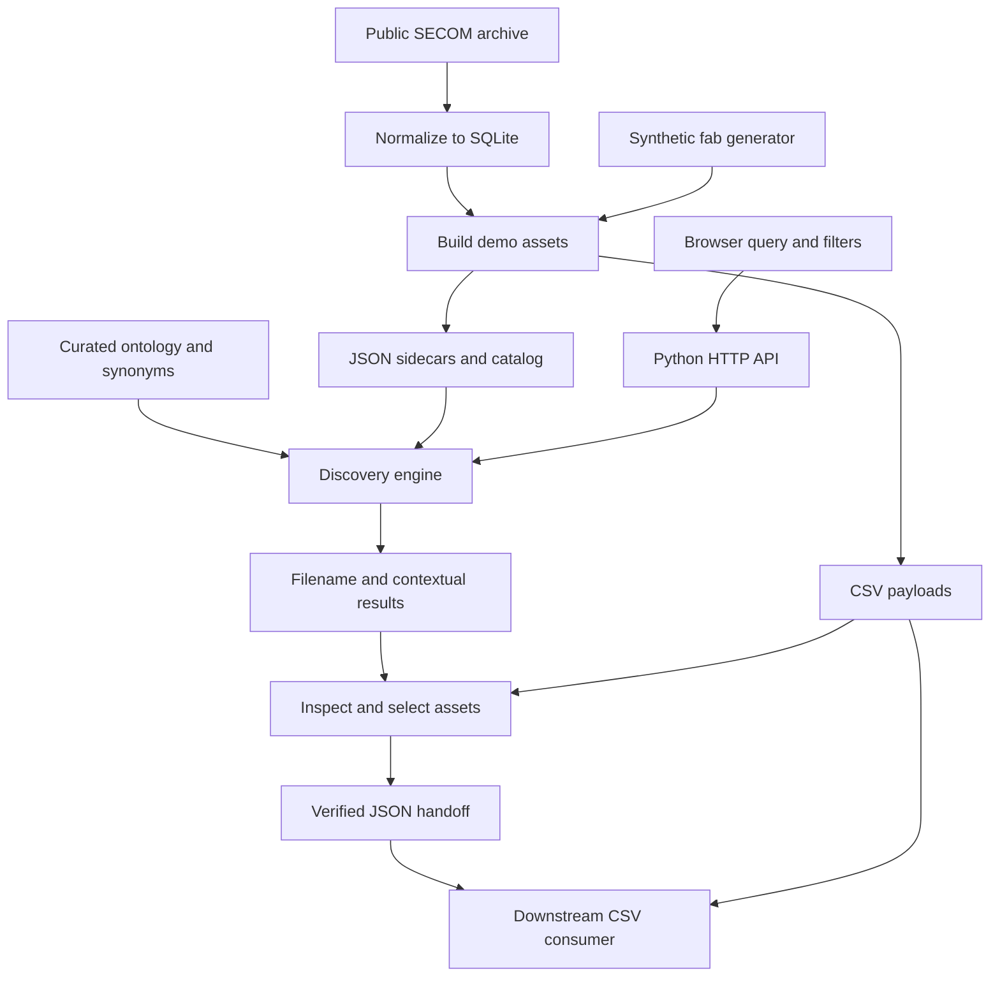

# Fab Context architecture

Fab Context lets an engineer search for manufacturing files by what they represent. A catalog stores file references and manufacturing metadata. A small Python service searches that catalog, explains what matched, and packages selected records for downstream use.

## Data flow

## Datasets and inputs

| Input | Contents | How the demo uses it |
|---|---|---|
| **Public SECOM** | 1,567 samples, 590 observed measurement columns, and 104 failures in the bundled source | Normalizes measurements, labels, and timestamps into SQLite, then publishes four discovery assets. Generated sample IDs align source rows. Physical sensor names, wafer IDs, and chamber IDs are unavailable. |
| **Synthetic fab scenario** | 48 trace CSVs and 48 wafer test CSVs, with generated wafer, lot, chamber, and recipe identities | Demonstrates trace-to-test discovery. A trace row represents a time point. A test record represents a wafer. The shared synthetic wafer ID connects the two files. |
| **Manufacturing vocabulary** | Human-authored terms, synonyms, and relationship descriptions in `ontology.json` | Expands known search terms and documents how the domain is represented. |
| **User request** | Query text, optional structured filters, and selected result IDs | Determines the search scope and which assets to export. |

The 100 discoverable assets each have a JSON sidecar under `data/metadata/`. The consolidated `data/catalog.json` contains searchable fields such as asset ID, path, source, data role, process step, units, grain, join key, and checksum. The catalog is rebuilt explicitly with `build_demo.py`.

## Methods and search logic

1. **Interpret the query.** For “Find etch sensor traces for failed wafers in chamber C2,” the engine recognizes etch, chamber C2, failed outcome, and feature role. Explicit filters override inferred values. The supported vocabulary is intentionally small.
2. **Run the filename baseline.** Compare query tokens with filename tokens. This baseline has no manufacturing filters.
3. **Run contextual discovery.** Expand query tokens through curated synonyms, filter on the effective metadata fields, and rank remaining matches by the number of shared tokens. Asset ID breaks ties. Missing values cannot satisfy a required chamber filter.
4. **Explain and inspect the result.** Return matched terms, applied filters, warnings, and asset references. The inspector verifies the file checksum, previews up to six CSV rows, and exposes related records. The synthetic trace-to-test link uses the wafer ID.
5. **Export and consume.** Export selected matching assets as a JSON contract. The example consumer resolves paths inside the repository, verifies checksums, rejects mixed real and synthetic populations, and loads the selected CSVs.

## Outputs

| Entry point | Output |
|---|---|
| `GET /api/search?q=...` | Filename hits, ranked contextual hits, matched terms, effective filters, and warnings |
| `GET /api/asset?id=...` | Asset metadata, sample rows, related records, and checksum verification |
| `GET /api/handoff?q=...&id=...` | Versioned JSON with the query, filters, selected file references, SHA-256 checksums, provenance, roles, grain, units, join keys, and consumer rules |
| `consume_handoff.py` | Verified load summary for selected CSVs |

For the etch query, the demo returned **zero filename hits and five contextual matches** in the synthetic dataset. The SECOM chamber query returned **zero matches** and identified the missing chamber context. Those outcomes describe the scripted cases. A production retrieval study would need representative questions and engineer-verified results.

## Tech stack and repository map

| Layer | Technology and entry point |
|---|---|
| Browser UI | HTML, CSS, and vanilla JavaScript in `web/index.html` |
| Local API | Python 3.10+ standard library HTTP server in `server.py`. Read-only endpoints listen on loopback by default. |
| Search and inspection | Python tokenization, synonym expansion, structured filters, JSON catalog scanning, CSV parsing, and SHA-256 verification in `discovery.py` |
| Data preparation | `poc.py build` normalizes SECOM to SQLite. `build_demo.py` generates CSVs and metadata. pandas is among the preparation dependencies. |
| Packaging and checks | Optional Docker Compose startup, Python unittest, and GitHub Actions workflow |
| Optional ontology integration | `auto_ontology_bridge.py` enriches a native model export. `agent_client.py` targets a separately running NVIDIA Auto-Ontology service. The service is outside the local demo flow and has yet to be tested end to end. |
| Separate ML example | `poc.py train` applies median imputation, variance filtering, scaling, and class-weighted logistic regression with a chronological SECOM holdout. This path uses the normalized SECOM data independently of the exported JSON contract. |

The visual demo starts with `python server.py` and needs only the bundled data and Python’s standard library. Open `http://127.0.0.1:8501` or the port printed in your terminal.

## What a fab pilot would validate

A production implementation would establish authoritative source mappings for run, wafer, chamber, recipe revision, and test outcome. Engineers would verify join cardinality and operation timing, especially after repeat processing. The prototype supplies a starting point for measuring whether metadata improves cohort accuracy and time to usable data. The search results describe records that meet the selected conditions and provide evidence for investigation.
